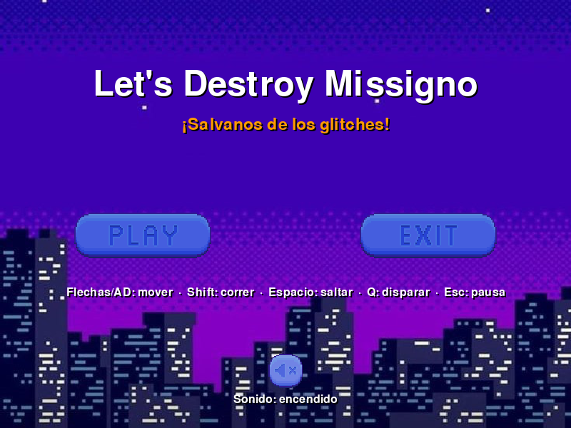
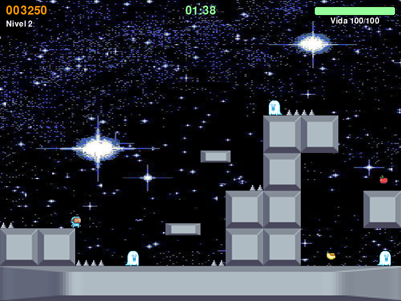
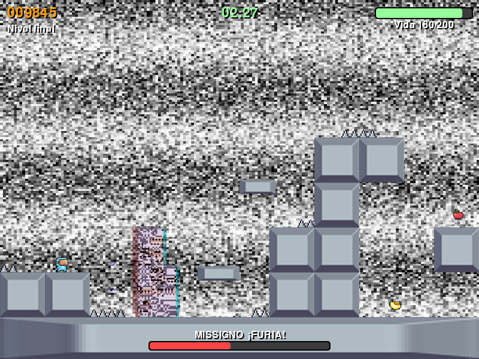

# Let's Destroy Missigno

Juego de plataformas 2D hecho en **Python + Pygame**. Missigno, un glitch con forma de jefe, se metió en el sistema: atravesá tres niveles, juntá las frutas, eliminá a los enemigos y derrotalo.



| Nivel 2 | Jefe final |
|---|---|
|  |  |

## Cómo jugar

```bash
pip install -r requirements.txt
python main.py
```

| Acción | Tecla |
|---|---|
| Moverse | ← → o A D |
| Correr | Shift |
| Saltar (mantener = salto más alto) | Espacio, ↑ o W |
| Disparar | Q o J |
| Pausa | Esc o P |
| Silenciar | M |
| Ver hitboxes y estado de la IA | F1 |

Para pasar de nivel hay que **juntar todas las frutas y eliminar a todos los enemigos** antes de que termine el tiempo. Las frutas recuperan la vida, el tiempo sobrante suma puntos y el mejor puntaje de cada jugador queda en `scores.csv`.

## Qué tiene adentro

- **Física independiente de los FPS**: velocidades en px/s, posición en floats y colisiones AABB resueltas eje por eje (paredes, techos y piso se comportan como sólidos de verdad).
- **Controles con buena sensación**: *coyote time*, *jump buffer* y salto de altura variable.
- **IA de enemigos con máquina de estados** (`PATROL`, `PAUSE`, `CHASE`, `SEARCH`): patrullan sin caerse de su plataforma ni pisar trampas, detectan al jugador con rango de visión y línea de visión, lo persiguen, mantienen distancia para disparar y, si les disparan por la espalda, se dan vuelta a buscarlo.
- **Jefe con fases**: Missigno siempre sabe dónde estás, salta si te subís a una plataforma y con media vida entra en *furia*: más rápido, dispara en abanico y se teletransporta con un efecto de glitch.
- **Niveles definidos como datos** (`game/levels.py`): un único motor (`game/level.py`) juega cualquier nivel.
- **Tests** de física, IA y puntajes.

## Estructura

```
main.py                 punto de entrada
game/
  app.py                flujo menú -> nombre -> niveles -> resultados
  level.py              bucle de un nivel: entrada, reglas, colisiones y HUD
  levels.py             diseño de los niveles
  screens.py            menú, ingreso de nombre y resultados
  ui.py                 botones, textos y barras
  assets.py             carga cacheada de imágenes y audio opcional
  scores.py             ranking en CSV
  settings.py           constantes globales
  entities/
    physics.py          cuerpo físico con colisiones
    player.py           jugador
    enemy.py            enemigo común y jefe (IA)
    bullet.py, items.py proyectiles, plataformas, trampas y frutas
    animation.py        animaciones por spritesheet
assets/                 imágenes (y música opcional, ver assets/music)
tests/                  tests con unittest
```

## Tests

```bash
python -m unittest discover -s tests -t .
```

Corren sin abrir ventana ni usar la placa de sonido.

---

Proyecto de la Tecnicatura Universitaria en Programación (UTN Avellaneda), refactorizado en 2026. Hecho por [Leandro Alvarez](https://leandroalvarez-dev.vercel.app).
